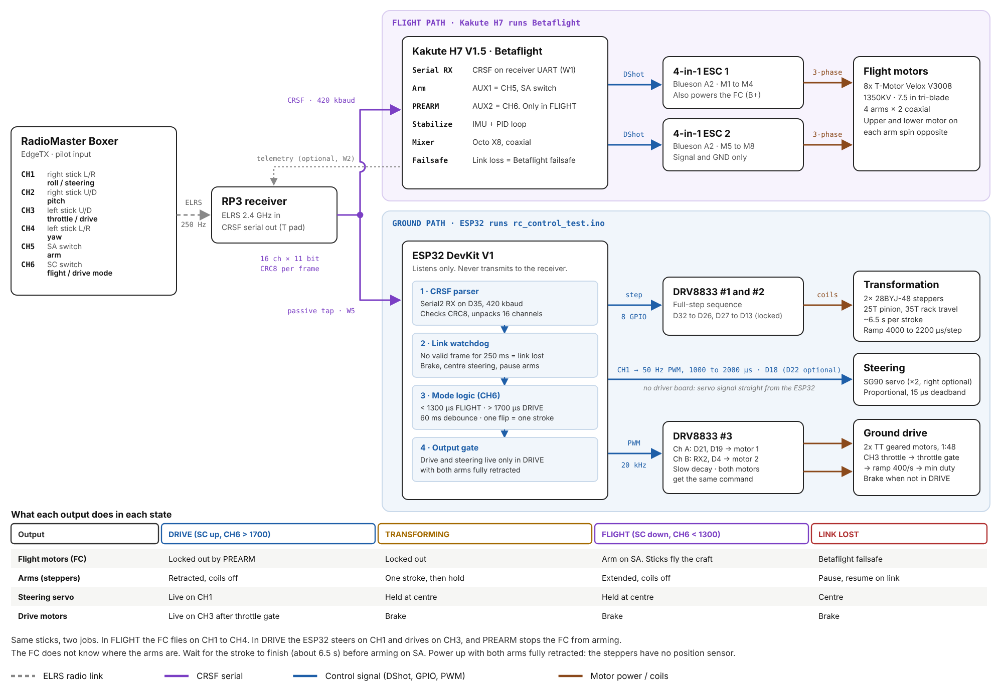
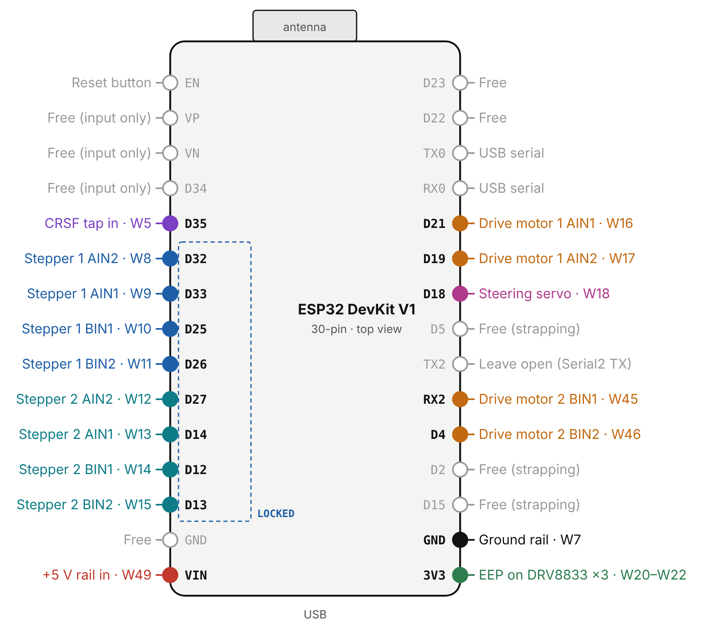

# RYZE OS V1

Ground controller firmware for the RYZE drive-and-fly prototype, a McMaster University capstone project. The vehicle drives on wheels and transforms into an X8 coaxial octocopter.

One RadioMaster Boxer controls both modes. A Kakute H7 running Betaflight flies the craft. An ESP32 runs this firmware and handles everything on the ground: arm transformation, steering, and drive.

## What the firmware does

- Reads RC channels from the RP3 receiver through a passive CRSF tap on D35. The ESP32 listens only and never transmits to the receiver.
- SC switch (CH6) picks the mode. Below 1300 us = FLIGHT, arms extend. Above 1700 us = DRIVE, arms retract.
- Two 28BYJ-48 steppers drive rack and pinion arms. One switch flip moves the arms one full stroke (about 6.5 s), then holds.
- Steering (CH1) drives an SG90 servo, proportional, DRIVE mode only.
- Throttle (CH3) drives two TT gear motors through a DRV8833, DRIVE mode only.
- In FLIGHT or mid-transform, the drive motors brake and steering holds centre.
- Throttle gate: after entering DRIVE, the motors stay off until the throttle stick returns to the bottom once.
- Link loss (no frame for 250 ms): motors brake, steering centres, arms pause and resume when the link returns.
- Betaflight PREARM on AUX2 (CH6) keeps the flight controller disarmed in DRIVE.

## Hardware

| Part | Role |
|---|---|
| ELEGOO ESP32 DevKit, 30-pin (ESP-WROOM-32) | Ground controller |
| RadioMaster Boxer, ELRS 2.4 GHz | Transmitter |
| RadioMaster RP3 | ELRS receiver, CRSF out |
| Holybro Kakute H7, Betaflight | Flight controller |
| 2x 28BYJ-48 on DRV8833 #1 and #2 | Arm transformation |
| SG90 servo | Steering |
| 2x TT gear motor on DRV8833 #3 | Ground drive |
| UBEC set to 5.2 V | 5 V rail, ESP32 powered through VIN |

## Pin map (REV G)

| Function | Pins |
|---|---|
| CRSF tap (RX only) | D35 |
| Stepper 1 (AIN2, AIN1, BIN1, BIN2) | D32, D33, D25, D26 |
| Stepper 2 (AIN2, AIN1, BIN1, BIN2) | D27, D14, D12, D13 |
| Steering servo | D18 |
| Drive motor 1 | D21, D19 |
| Drive motor 2 | RX2 (GPIO16), D4 |

Leave TX2 (GPIO17) unconnected. Serial2 parks its TX there. Full wiring: [docs/wiring-block-diagram-rev-g.pdf](docs/wiring-block-diagram-rev-g.pdf).

## Build and upload

1. Install the Arduino IDE and the ESP32 board package (core 2.x or 3.x both work).
2. Open `REV1RYZEOS/REV1RYZEOS.ino`. No extra libraries needed.
3. Board: "ESP32 Dev Module".
4. Upload. If the upload fails, unplug the D12 wire, upload, then reconnect. D12 is a strapping pin.
5. Open the Serial Monitor at 115200 baud, line ending "Newline". Type `h` for help.

## Bench mode without a radio

Set `RC_FROM_SERIAL = true` near the top of the sketch. Typed commands then stand in for the Boxer:

| Command | Effect |
|---|---|
| `drive` / `flight` / `mid` | SC switch up / down / middle |
| `t 40` | Throttle 40 % |
| `s -60` | Steering 60 % left |
| `c` / `x` | Steering centre / throttle zero |
| `link off` / `link on` | Simulate radio link loss |

Other commands work in both modes: `ext`, `ret`, `stop`, `j1 N`, `j2 N`, `zero`, `spd N`, `find`, `md N`, `info`, `p`.

## Startup rules

1. Power up with both arms fully retracted. The steppers have no position sensor, so the code treats boot position as retracted.
2. If SC reads FLIGHT at boot, nothing moves. Flip SC to DRIVE, then back to FLIGHT.
3. Wait for the stroke to finish (about 6.5 s) before arming on SA. The flight controller does not know where the arms are.
4. D14 pulses at boot. One twitch on stepper 2 is normal.

## Tuning

- Drive motor start duty: arms retracted, wheels off the bench, type `find`, press Enter the moment both wheels turn. Copy the printed value into `MOTOR_MIN_DUTY_DEFAULT`.
- Stepper speed: `spd N` sets microseconds per step. Default 2200. Below about 1800 the 28BYJ-48 starts to skip under load.
- Rack moving the wrong way: flip `M1_EXTEND_DIR` or `M2_EXTEND_DIR`.
- Wheel spinning backward: set `MOTOR1_INVERT` or `MOTOR2_INVERT`.
